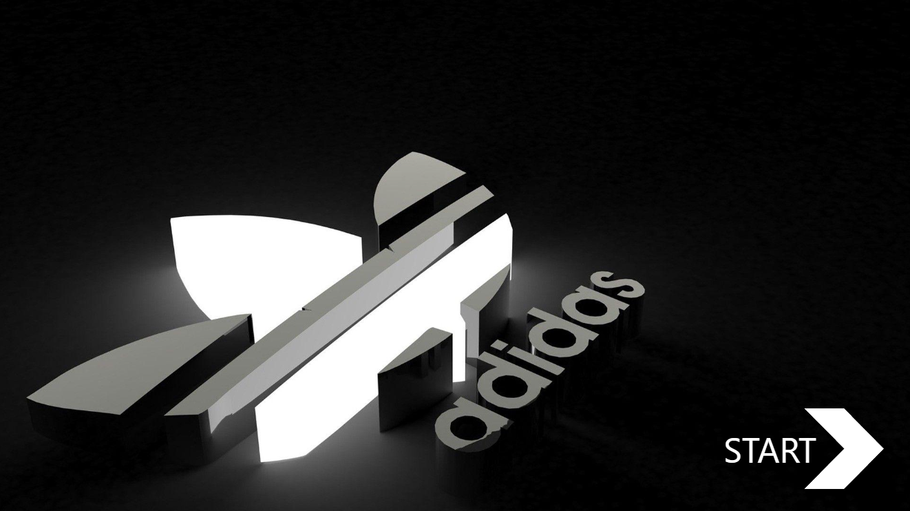
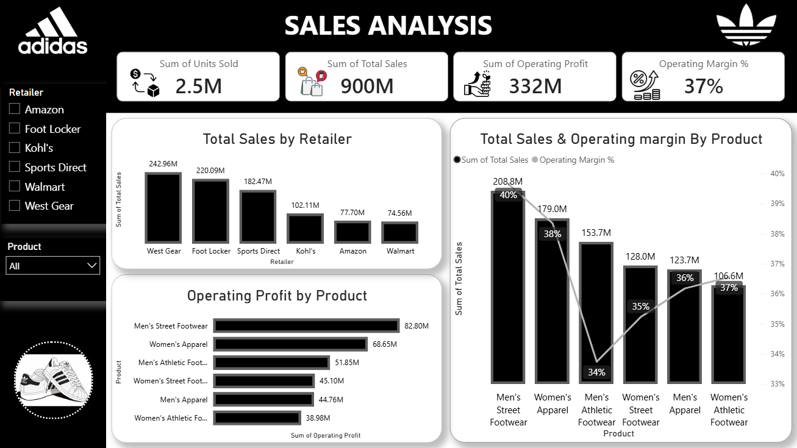
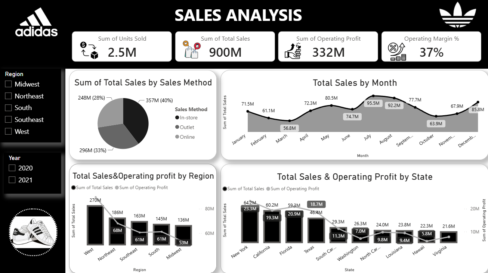

# Adidas Sales Analysis Dashboard

Interactive Power BI dashboard analyzing Adidas sales performance across retailers, products, regions, states and sales methods, with slicers for retailer, product, region and year. The data covers 2020 and 2021.

> This is an independent portfolio project and is not affiliated with Adidas.

## Business Questions
- Which retailers and products drive the most sales and profit?
- Which products have the best operating margins?
- Which regions and states perform best?
- How do sales vary by sales method and by month?

## Tools
- Power BI (data modeling, DAX measures, interactive dashboards)

## Dashboard Pages

### 1. Sales Analysis | Retailers & Products

- 2.5M units sold, 900M total sales, 332M operating profit, 37% operating margin
- West Gear leads retailer sales (242.96M), followed by Foot Locker (220.09M) and Sports Direct (182.47M). These three account for about 72% of total sales
- Amazon (77.70M) and Walmart (74.56M) have the lowest sales
- Men's Street Footwear is first in sales (208.8M), operating profit (82.80M) and operating margin (40%)
- Men's Athletic Footwear has the lowest margin (34%) despite ranking third in sales (153.7M)

### 2. Sales Analysis | Regions & Trends

- In-store is the largest sales method (40%), followed by Outlet (33%) and Online (28%)
- Sales peak in July (95.5M) and are lowest in March (56.8M)
- West is the top region (270M, about 30% of total sales), and Midwest is the lowest (136M)
- Among the top 10 states, New York (64.2M), California (60.2M) and Florida (59.3M) lead in sales
- Texas ranks fourth in sales (46.4M) but generates 18.7M in operating profit

## Key Takeaways
- Prioritize Men's Street Footwear, which combines the highest sales and margin
- Review pricing and costs for Men's Athletic Footwear to improve its 34% margin
- Online is the smallest channel (28%), so there is room to grow it
- Plan inventory and marketing around the July peak, and run promotions in slower months such as March and October
- Keep strengthening the top 3 retailers while finding ways to grow Amazon and Walmart

## Dataset
The dataset was sourced from [Kaggle](https://www.kaggle.com/).

## Author
**Radwa Khater** | Data Analyst
[LinkedIn](https://www.linkedin.com/in/radwa-khater)
